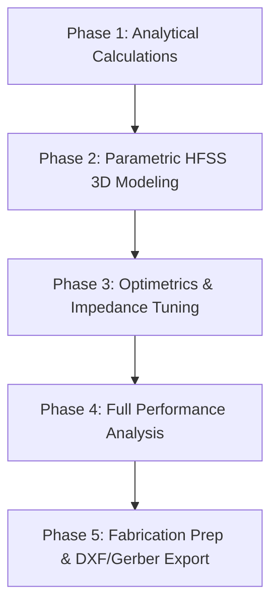

# Implementation Plan: Design, Simulation & Fabrication of a 2.45 GHz Bluetooth/ZigBee Microstrip Patch Antenna

This project covers the full end-to-end workflow to **design, simulate, analyze, and prepare for fabrication** a 2.45 GHz Microstrip Patch Antenna for Bluetooth and ZigBee-enabled IoT applications using **Ansys HFSS**.

## Project Objective & Target Specifications

- **Application:** Bluetooth (IEEE 802.15.1) & ZigBee (IEEE 802.15.4) IoT Devices
- **Operating Frequency Band:** 2.400 GHz – 2.4835 GHz (ISM Band)
- **Center Frequency ($f_0$):** 2.45 GHz
- **Substrate Material:** FR-4 Glass Epoxy ($\varepsilon_r = 4.4$, $\tan\delta = 0.02$, $h = 1.6\text{ mm}$, Copper thickness $t = 35\ \mu\text{m}$ / 1 oz copper)
- **Feed Mechanism:** Inset-Fed Microstrip Line (50 $\Omega$ SMA Connector compatible)
- **Target Performance Metrics:**
  - Return Loss ($S_{11}$): $\le -15\text{ dB}$ at 2.45 GHz
  - -10 dB Bandwidth: $> 83.5\text{ MHz}$ (covering 2.400 – 2.4835 GHz)
  - VSWR: $< 1.5$ at 2.45 GHz
  - Input Impedance: $50 \pm 5\ \Omega$ (matched on Smith Chart)
  - Peak Gain: $> 2.0\text{ dBi}$ with broadside radiation pattern

---

## Tool Suitability: ANSYS HFSS vs. CST Studio Suite

> [!NOTE]
> **Is this possible using ANSYS or CST?**
> **YES!** Both ANSYS HFSS and CST Studio Suite are industry-standard 3D EM solvers used worldwide for microstrip antenna design and fabrication preparation.
> 
> - **ANSYS HFSS (Recommended for your setup):** Uses the Finite Element Method (FEM) solver. Since **Ansys Electronics Desktop Student** is already installed and verified on your PC, we will execute the entire project directly in ANSYS HFSS.
> - **CST Studio Suite:** Uses Time Domain (FIT) solver. The same design principles, dimensions, and Gerber export workflows apply identically in CST if needed.

---

## Detailed Project Phases

### Phase 1: Analytical Design & Dimension Calculation
We will calculate the precise physical dimensions using Transmission Line Model equations at $f_0 = 2.45\text{ GHz}$ on FR-4 ($h = 1.6\text{ mm}, \varepsilon_r = 4.4$):

1. **Patch Width ($W$):**
   $$W = \frac{c}{2 f_0} \sqrt{\frac{2}{\varepsilon_r + 1}} \approx 37.4\text{ mm}$$
2. **Effective Dielectric Constant ($\varepsilon_{eff}$):**
   $$\varepsilon_{eff} = \frac{\varepsilon_r + 1}{2} + \frac{\varepsilon_r - 1}{2} \left[1 + 12 \frac{h}{W}\right]^{-1/2} \approx 4.08$$
3. **Effective & Actual Patch Length ($L$):**
   $$\Delta L = 0.412 h \frac{(\varepsilon_{eff} + 0.3)(W/h + 0.264)}{(\varepsilon_{eff} - 0.258)(W/h + 0.8)} \approx 0.73\text{ mm}$$
   $$L = \frac{c}{2 f_0 \sqrt{\varepsilon_{eff}}} - 2\Delta L \approx 28.9\text{ mm}$$
4. **50 $\Omega$ Microstrip Feedline Width ($W_f$):**
   $$W_f \approx 3.02\text{ mm}$$
5. **Inset Notch Depth ($F_i$) & Notch Gap ($g$):**
   $$F_i \approx 9.6\text{ mm}, \quad g \approx 1.0\text{ mm}$$
6. **Substrate & Ground Dimensions ($Sub_X \times Sub_Y$):**
   $$Sub_X = L + 6h \approx 60\text{ mm}, \quad Sub_Y = W + 6h \approx 60\text{ mm}$$

---

### Phase 2: Parametric 3D Modeling in ANSYS HFSS
Instead of static numbers, we will build a **fully parametric HFSS model** using Design Variables (`L`, `W`, `Wf`, `Fi`, `g`, `SubX`, `SubY`, `h`).

1. **Variables Creation:** Define all mathematical expressions as design variables in HFSS so tuning requires no redraws.
2. **Substrate & Ground Creation:** 3D Box for FR-4 Dielectric ($60 \times 60 \times 1.6\text{ mm}$) and 2D Ground Plane ($60 \times 60\text{ mm}$).
3. **Patch & Inset Feed Geometry:** 2D Sheet with inset notch cutouts united with the 50 $\Omega$ feedline.
4. **50 $\Omega$ Port & Integration Line:** Wave Port or Lumped Port calibrated with a vertical 1.6 mm integration line from Ground to Feedline.
5. **Radiation Boundary Box:** Air box set to $\lambda/4$ distance around all non-ground boundaries with Radiation boundary condition.

---

### Phase 3: Simulation & Optimetrics Tuning
1. **Adaptive Mesh Solution Setup:** Driven Modal setup at $f_0 = 2.45\text{ GHz}$ with 20 maximum passes and $\Delta S < 0.02$.
2. **Frequency Sweep:** Discrete / Interpolating sweep from $2.0\text{ GHz}$ to $3.0\text{ GHz}$ with $0.005\text{ GHz}$ (5 MHz) step resolution.
3. **Optimetrics Sweep:** Sweep inset feed depth $F_i$ ($8.0\text{ mm}$ to $11.0\text{ mm}$) to achieve exact $50\ \Omega$ resonance and maximum return loss depth ($S_{11} < -20\text{ dB}$).

---

### Phase 4: Performance Analysis & Documentation
We will extract and document the following plots for your project report:
1. **$S_{11}$ Return Loss Plot:** Verify $-10\text{ dB}$ bandwidth covers $2.400 - 2.4835\text{ GHz}$.
2. **VSWR Plot:** Verify $\text{VSWR} < 1.5$ across the band.
3. **Smith Chart:** Verify input impedance locus passes through the $50\ \Omega$ center point at $2.45\text{ GHz}$.
4. **2D Far-Field Radiation Patterns:** E-plane ($\phi = 0^\circ$) and H-plane ($\phi = 90^\circ$) polar gain cuts.
5. **3D Radiation Pattern & Gain:** 3D Polar plot showing peak gain ($\text{dBi}$) and directivity.
6. **Overlay Fields:** 2D Vector E-Field and Surface Current Distribution ($\text{A/m}$) on the patch metal.

---

### Phase 5: Fabrication Readiness & File Export
To physically manufacture (fabricate) the antenna:
1. **SMA Connector Footprint:** Add edge launcher SMA connector pad dimensions ($50\ \Omega$ SMA Jack).
2. **Export DXF / Gerber Files:** Export 2D layout layers (`Top Copper Patch` and `Bottom Ground`) from HFSS modeler to **AutoCAD DXF** or **Gerber RS-274X** format.
3. **Fabrication Guidelines Document:**
   - PCB Board specification (FR-4, 1.6mm thickness, 1 oz / 35um copper, double-sided).
   - PCB Milling / Chemical Etching instructions.
   - Soldering procedure for 50 $\Omega$ End-Launch SMA connector.
   - Testing procedure using a Vector Network Analyzer (VNA).

---

## Verification Plan

### Automated / Software Verification
- **Solution Convergence:** Confirm HFSS adaptive pass converges with $\Delta S < 0.02$.
- **$S_{11}$ Check:** Confirm $S_{11} \le -15\text{ dB}$ at $2.45\text{ GHz}$.
- **Impedance Check:** Confirm $Z_{in} = 50 \pm 5\ \Omega$ at $2.45\text{ GHz}$.

### Physical Fabrication & Test Verification
- Export Gerber/DXF layout files ready for PCB fabrication.
- Provide step-by-step soldering and Vector Network Analyzer (VNA) measurement protocol.
